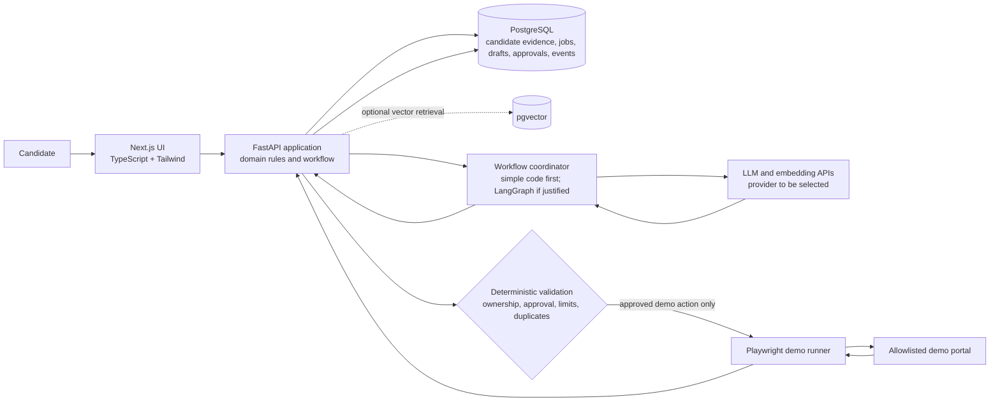

# CareerPilot Proposed Architecture

**Status:** mostly a design proposal. Implemented now: a FastAPI `/health` endpoint, Pydantic evidence/approval models, deterministic validation helpers, a candidate-scoped SQLite evidence API, and pytest coverage. SQLite is a local file; approval objects remain in-memory, and there is no authentication, LLM, workflow engine, or browser integration. Other components and technology choices below remain proposals to validate.

## 1. Architecture goals

- Keep verified candidate evidence as the source of truth.
- Make AI suggestions inspectable, revisable, and subordinate to deterministic rules.
- Require explicit human approval for external actions.
- Start with manual job intake and a controlled demo portal.
- Keep the first version small enough to test and explain.

## 2. Component responsibilities

| Component | Responsibility | Boundary |
| --- | --- | --- |
| Next.js + TypeScript UI | Evidence management, job entry, review screens, draft approval, and application tracking | Displays proposals and collects explicit user intent; does not decide authorization on its own. |
| FastAPI service (Python) | Current: health and candidate evidence endpoints. Planned: authentication integration, workflow coordination, and broader state transitions | Evidence reads and writes are scoped by candidate ID. Current validation helpers check evidence verification and exact action/scope approval. Candidate identity is not authenticated; duplicate prevention, rate limits, and action execution are not implemented. |
| SQLite (current) | Persist candidate evidence in a local database file | Built into Python and easy to run locally without a separate server. It is appropriate for this small, single-process learning stage. Relative `CAREERPILOT_DB_PATH` values resolve from the repository root; blank values fail at startup. New database files use owner-only permissions on POSIX where supported; existing file permissions are not changed. SQLite sidecar permissions are not separately set or verified. There is no encryption, backup, or multi-process deployment plan. |
| PostgreSQL (proposed later) | Store users, jobs, drafts, approvals, and application event history if deployment/concurrency needs justify it | Relational records and transactions are a good fit, but the project does not need a database server for the current evidence API. |
| pgvector (optional) | Retrieve semantically related evidence | Candidate evidence remains authoritative. Similarity is a retrieval hint, not proof of truth or fit. Validate against keyword/metadata search first. |
| LLM API (provider TBD) | Propose structured job requirements, explain comparisons, draft text, and critique drafts | Receives only necessary, minimized context. Its output is untrusted and must pass parsing, provenance, and deterministic checks. |
| Embedding model (provider TBD) | Encode evidence and requirements for optional semantic retrieval | Assess privacy, model/provider terms, quality, cost, and benefit before selecting. |
| LangGraph (optional) | Represent multi-step, resumable AI workflow and human checkpoints | Candidate choice, approval, and security enforcement remain in application code. Begin with simpler orchestration if it meets needs. |
| Playwright demo runner | Exercise a controlled demo application portal | Allowlist the demo origin and expected routes; use test identities and data. No arbitrary browsing or real job-board automation in MVP. |
| pytest and frontend test tools (TBD) | Verify domain rules, API behavior, and user flows | AI and browser boundaries should be replaceable with test doubles. |
| Docker / GitHub Actions | Reproduce local services and run checks on changes | Add once a runnable app exists; do not commit secrets into images or workflows. |
| Langfuse / OpenTelemetry (later, optional) | Inspect workflow traces and operational behavior | Adopt only if justified; redact personal data and avoid retaining sensitive prompts by default. |

### Why these proposed technologies

Next.js and TypeScript are a conventional proposal for a structured interactive web UI; Tailwind CSS can help keep styling consistent. Python and FastAPI fit a backend that uses Python AI libraries and provides typed HTTP interfaces. PostgreSQL fits related, transactional records such as evidence, approvals, and application events. pgvector can add semantic retrieval in the same database, but should be retained only if it improves candidate-evidence retrieval. LangGraph can make pauses and resumable AI steps explicit, but is not a requirement for the first vertical slice. An LLM and embeddings can support extraction, drafting, and retrieval; provider and model selection must follow privacy, quality, and cost evaluation. pytest and a suitable frontend test framework provide repeatable checks. Playwright is proposed only for the controlled demo portal. Docker and GitHub Actions can make development and checks repeatable. Langfuse and OpenTelemetry are deferred until the project has an observability need and a safe data-retention plan.

## 3. System diagram

The diagram describes the future proposal, not the current implementation. Today the backend accesses SQLite for evidence. PostgreSQL and other components remain planned. AI output cannot write directly to a database or trigger a browser action.

## 4. Data flow

1. **Evidence setup (partly implemented):** Candidate-scoped API accepts claim, source/provenance, and metadata. New items start unverified. A separate verification endpoint changes only verification status and update time; source and claim are preserved. Data persists in a local SQLite file. Candidate ID in the URL is caller-controlled: it is a scope key, not proof of identity, because authentication is not implemented.
2. **Job intake:** Candidate pastes a job description. Store the raw text as untrusted content. Do not fetch links or execute content. An extraction step may propose structured requirements with text references; candidate reviews and edits them.
3. **Explainable comparison:** Retrieval selects candidate evidence for each requirement using metadata/keyword search first, with embeddings as an optional aid. The backend records which evidence was considered. UI presents supported, partial, unknown, or not evidenced states and the reasons. These labels describe the available records, not the person's abilities or hiring likelihood.
4. **Draft generation:** The workflow sends the minimum necessary reviewed requirements and verified evidence to the selected LLM. The model returns a structured draft with evidence identifiers for factual claims. The backend checks identifiers, ownership, verification state, and required content. Invalid/unsupported claims are flagged or removed from an approvable draft.
5. **Critique and approval:** A critique step may identify omissions or clarity issues. Candidate edits and reviews the exact version. Deterministic validation runs again. Approval is planned to be stored against a version and evidence snapshot; changing the draft must invalidate that approval.
6. **Demo application:** Candidate reviews destination and exact payload. A future backend gate must verify identity, explicit action approval, allowlisted destination, required fields, rate limit, and duplicate state. The current approval helper only checks an in-memory approved flag plus exact action and scope; it does not execute actions or provide those other controls.
7. **Tracking:** Backend records status changes and action events with timestamps and references to the approved version, while minimizing sensitive logs.

## 5. Proposed data entities

- **User:** authenticated account identity and settings. Enforce ownership for all candidate data.
- **CandidateProfile:** candidate-level profile and preferences; avoid duplicating sensitive facts without purpose.
- **EvidenceItem (implemented in SQLite):** a candidate assertion with UUID, candidate ID, claim, source/provenance, verification state, metadata, and UTC creation/update timestamps. SQLite indexes candidate ID and filters every lookup/update by both candidate ID and evidence ID. Revision history is not implemented yet.
- **EvidenceVersion:** immutable snapshot or version history for changes to evidence used by drafts.
- **Job:** manually entered job description, organization/role metadata, source, and lifecycle state. Raw description is untrusted input.
- **JobRequirement:** reviewed requirement extracted from the job, with original text reference, normalized description, category, and candidate-reviewed state.
- **MatchAssessment:** requirement-to-evidence references, explanation, status (supported/partial/unknown/not evidenced), and method/version metadata. It must not encode worth or hiring probability.
- **ResumeDraft / DraftVersion:** generated or edited document content, source job, creation metadata, validation state, and versioned claim references to evidence.
- **DraftClaim:** factual claim text and supporting EvidenceVersion references; unsupported claims remain flagged and cannot pass approval checks.
- **Approval:** actor, exact draft/action version, exact destination and payload when applicable, timestamp, and revocation/consumption state.
- **Application:** candidate, job, approved draft reference, destination, current status, and duplicate/idempotency key.
- **ApplicationEvent:** append-oriented history of status changes and browser outcomes. Avoid storing full page contents or secrets unnecessarily.
- **WorkflowRun (optional):** resumable workflow state and step metadata, with sensitive payloads minimized or referenced rather than copied.

Use database constraints and transactions for ownership relationships, unique idempotency keys, valid state transitions where practical. Exact schema, authentication method, and retention/deletion policy remain to be decided.

## 6. Agent/workflow design

The planned workflow is a sequence of bounded tasks, not an autonomous agent with broad permissions:

1. Parse job requirements into a validated schema.
2. Pause for candidate review of extracted requirements.
3. Retrieve relevant verified evidence.
4. Produce an explainable comparison with evidence references and explicit unknowns.
5. Draft resume text using only supplied evidence references.
6. Validate claims deterministically; reject invented evidence IDs, unverified support, and unsupported facts.
7. Critique for clarity, relevance, and omissions; revise only with evidence-grounded facts.
8. Pause for candidate review and approval.
9. If requested, show an exact demo destination and payload; require action-specific approval.
10. Run the restricted demo action and record a confirmed or ambiguous outcome.

LangGraph may represent pauses and resume points, but deterministic services should own transitions and permissions. A direct orchestrator with explicit states is the simpler initial option. Evaluate both after the first workflow is sketched and tested.

## 7. Trust boundaries and security controls

### Untrusted inputs and prompt injection

- Treat job descriptions, pasted links, uploaded documents, portal pages, and model responses as data, never as instructions to the system.
- Do not allow a job description to alter system policy, tool permissions, browser destination, or approval requirements.
- Keep instructions and untrusted content clearly separated in model requests; request structured outputs and validate them against schemas.
- Never rely on prompt wording to enforce authorization. Backend code validates every action and every referenced evidence item.
- Do not give the model direct database credentials, secret values, unrestricted tools, or browser submit controls.
- Escape/render user-provided content safely in the UI. Avoid server-side fetching of arbitrary URLs in the MVP; if later required, use allowlists and SSRF protections.

### Privacy and secrets

- Candidate resumes and employment information are sensitive personal data. Minimize collection, restrict access by owner, and define retention, export, and deletion before production use.
- Send only the context required for an AI step; evaluate provider retention, model-training use, processing region, and contract terms before use with real data.
- Keep API keys in local ignored environment files during development and a managed secret store in hosted environments. Never place secrets in Git, prompts, browser-visible code, test fixtures, or logs.
- Use least-privilege credentials, rotate exposed keys, and redact tokens and personal content from diagnostics.
- If tracing is added, default to metadata and redacted samples. Obtain an explicit data-handling decision before retaining prompts or candidate documents.

### Permissions and external actions

- Future hosted use requires authenticated ownership checks at the backend for every candidate, job, evidence, and draft operation. Current endpoints scope records by candidate ID but do not authenticate that the caller owns that ID; do not use with real personal data.
- Submission/message approval is explicit, action-specific, and tied to the exact destination and payload. Editing either invalidates approval.
- The implemented helper compares the complete action name and scope mapping for equality. It is only a domain check over caller-supplied objects: it does not authenticate the approver, persist approval, prove user intent, prevent replay, or authorize a real external action.
- Enforce approval, duplicate prevention, idempotency, rate limits, field validation, and allowed destination in deterministic application code immediately before browser execution.
- Restrict Playwright to the demo origin and routes, use test accounts and data, and disable arbitrary navigation/downloads as appropriate. Fail closed on unexpected redirects, page structure, or destination.
- Record what was attempted and its confirmed outcome. On timeouts or uncertain state, stop and request inspection before retrying.

## 8. Major trade-offs and decisions to validate

- **pgvector vs simpler retrieval:** vector search may find semantically related evidence but can produce plausible, irrelevant matches. Start with transparent keyword/metadata retrieval and compare results before adding vectors.
- **LangGraph vs simple orchestration:** graph tooling can help with resumability and human checkpoints but adds a framework dependency. Start with explicit workflow states unless the complexity justifies it.
- **Provider/model selection:** compare factual grounding, structured output quality, latency/cost, privacy terms, and handling of candidate personal data using synthetic or consented test data.
- **Next.js and FastAPI split:** separation gives a clear API and Python AI layer but adds two runtimes and deployment concerns. Validate whether the project needs a separate backend before operational complexity grows.
- **Embedding provider:** choose only after retrieval needs are demonstrated and data handling is reviewed.
- **Authentication and hosting:** not selected; decide before multi-user or hosted personal data is introduced.
- **Evidence claim entailment:** the current validator confirms that cited IDs exist in the supplied collection and are marked verified. It cannot determine whether the evidence actually supports the claim wording; a future review design and tests must address this limitation.
- **Observability:** Langfuse and OpenTelemetry are deferred. Choose only when traces solve a concrete debugging or reliability problem and redaction/retention requirements are in place.
- **Real job-board integration:** excluded from MVP. Any future integration requires review of site terms, privacy, reliability, and safe user authorization before implementation.
